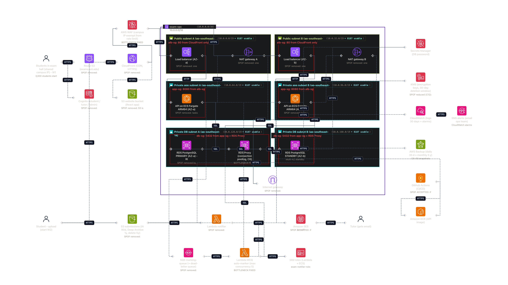

# Task 1: Revised Architecture Design

This is the final, cost-optimised version of my Assignment 2 exam platform, redesigned to run in **Asia Pacific (Singapore), `ap-southeast-1`**. It still meets the same targets:

| Target | Value |
|---|---|
| RPO | 5 minutes |
| RTO | 1 hour |
| Availability Zones | Survives the loss of one AZ |
| File retention | 5 years |
| Budget | USD 1,000 per month, averaged over the year |
| Load | 10 normal months (300–500 concurrent users); 2 exam months (peak of 3,000 students starting one exam within 5 minutes) |

The Assignment 2 diagram is kept in [`assignment2-baseline.png`](assignment2-baseline.png), only as the "before" picture for the change log in section 4.

---

## 1. Revised architecture diagram

The architecture is built in the **Cloud Architecture Lab** simulator. To open it, import [`assignment3.json`](assignment3.json) into the Lab. It has the same format as the Assignment 2 workspace, with every Assignment 3 change applied.

- Every node has a **note** saying whether it is a **SPOF removed**, a **SPOF accepted** or a **bottleneck fixed**. Click a node in the Lab to see it.
- Every change is tagged with its change-log number (C1–C15, section 4) in the node label or its configuration.
- The saved scenario is **W1: Student opens exam and answers autosave**, at **peak** traffic.

*Figure 1: Assignment 3 architecture in the Cloud Architecture Lab (Singapore, ap-southeast-1)*

*Figure 2: W1 simulation at peak traffic, decision trace*

*Figure 3: AZ-a failed in the simulation; traffic continues through AZ-b*

Legend used in the node notes and in the table below:
- 🟢 **SPOF removed**: redundant across two AZs, or a managed multi-AZ service
- 🔴 **SPOF accepted**: kept on purpose, with the reason
- 🟠 **Bottleneck**: where the platform slows down first under load

## 2. How a request flows (summary)

The request path now has two new hops compared with Assignment 2 (WAF and RDS Proxy).
1. Users reach the site through Route 53 and CloudFront, protected by WAF.
2. CloudFront serves the static app from S3, and sends `/api/*` requests through **WAF** to the ALB.
3. The ALB spreads requests over Fargate API tasks in two AZs.
4. The API writes through **RDS Proxy** to RDS PostgreSQL, which is Multi-AZ with a synchronous standby.
5. Uploads go straight from the browser to S3 with a presigned POST.
6. Marking goes through SQS to a Lambda, and upload emails go through a notifier Lambda to SES.

What changed is **where** it runs (Singapore), **how much capacity** runs and when, and fixes for **two bottlenecks** I found by reviewing the Assignment 2 code against the 3,000-student peak (see section 3).

## 3. Single points of failure and bottlenecks

| # | Component | Status | Why it is (or is not) a single point of failure | How it is removed or accepted |
|---|---|---|---|---|
| 1 | **RDS primary** | 🟢 Removed | All answers are in one database | Multi-AZ synchronous standby in AZ b. Automatic failover takes about 1–2 minutes, and no committed data is lost (RPO ≈ 0). Point-in-time restore covers corruption (RPO 5 minutes). |
| 2 | **NAT gateway** | 🟢 Removed | Private tasks need outbound access (ECR image pulls, Secrets Manager, SQS, CloudWatch, Cognito JWKS) | One NAT per AZ, and each AZ routes to its own NAT. A single shared NAT would save about USD 43 a month, but losing its AZ would cut off the healthy AZ, so I **kept two**. |
| 3 | **API tasks (ECS)** | 🟢 Removed | One task, or all tasks in one AZ, would be a SPOF | At least one task per AZ at all times. During exam windows, at least 8 tasks (4 per AZ), so one AZ alone can carry the peak. The ALB stops sending traffic to a failed AZ within about 20 seconds (2 failed checks × 10 s). |
| 4 | **Load balancer, CloudFront, Route 53, S3, SQS, Lambda, Cognito, Secrets Manager, KMS** | 🟢 Removed | — | AWS-managed services that are multi-AZ or global by design |
| 5 | **Single Region (Singapore)** | 🔴 Accepted | If the whole Region is lost, the platform is down | A second "warm" Region would roughly double the network and database cost and break the budget. The targets only ask to survive the loss of one **AZ**. AWS Backup snapshots allow a rebuild in another Region with Terraform, but that would take longer than the 1-hour RTO. **This risk is accepted and documented.** |
| 6 | **SES (email)** | 🔴 Accepted | If SES is down, tutors don't get "new submission" emails | The file is still stored safely in S3, and the notifier retries twice and then sends the event to a DLQ. Email is a notification, not part of the exam itself. |
| 7 | **KMS key** | 🟢 Reduced | If the key were deleted by mistake, encrypted data could not be read | ✏️ Deletion window raised from 7 to 30 days, which is the maximum time to cancel a deletion. |
| 8 | **CI/CD (GitHub Actions, ECR)** | 🔴 Accepted | If GitHub is down, we can't deploy | It doesn't affect the running platform. Tasks already running keep their image. |
| 9 | **WAF rate limit** | 🟠 Bottleneck, fixed | The Assignment 2 rule blocks any IP above **2,000 requests per 5 minutes**. In an exam hall, hundreds of students share **one campus public IP**. Autosave alone is 3,000 ÷ 30 s = 100 requests per second, which is **30,000 per 5 minutes** — **15 times** the limit. WAF would block the exam. | ✏️ Exempt the university's IP range from the rate rule (an IP-set allow rule), and keep a per-IP limit for everyone else |
| 10 | **Database connections** | 🟠 Bottleneck, fixed | The API opens a **new TLS connection to PostgreSQL for every request** and closes it afterwards. At 100+ requests per second, the database spends its CPU on connection handshakes and can run out of `max_connections`. | ✏️ **RDS Proxy** between the API and RDS: API tasks and the marker Lambda share a small pool of reused connections. RDS Proxy is managed and multi-AZ, and during an RDS failover it holds client connections and reconnects to the new primary, which also shortens recovery. To be **proven with CloudWatch in the load test** (Task 3). |
| 11 | **Marker Lambda → RDS** | 🟠 Bottleneck, fixed | When 3,000 students submit at once, SQS scales the marker Lambda up, and each copy opens its own database connection | ✏️ The SQS event source gets `maximum_concurrency = 5`. Jobs wait safely in the queue, and the alarm on message age shows any backlog. |

## 4. Change log against Assignment 2

| # | Area | Assignment 2 | Assignment 3 | Reason (cost, test finding or resilience) |
|---|---|---|---|---|
| C1 | Region | `us-east-1` | **`ap-southeast-1` (Singapore)** | Required by the brief. About 3,100 km from Bhutan, compared with more than 12,000 km for us-east-1, so latency is much lower (compared in `docs/cost-report.md`). CloudFront's WAF and ACM certificate stay in us-east-1, because CloudFront requires that. |
| C2 | API compute | x86 Fargate, 0.5 vCPU / 1 GB, 2 tasks always | **ARM64 (Graviton) Fargate**, same size, 2 tasks normally | About 20% cheaper per vCPU-hour, for the same Python code. The Docker image is built for `linux/arm64`. |
| C3 | Exam scaling schedule | Scaled to 8 tasks **every weekday all year** | Scaled to 8 tasks **only on exam days**, in the 2 exam months | Assignment 2 paid for exam capacity about 250 days a year when it was only needed for about 40. |
| C4 | Savings Plan | On-Demand | **1-year Compute Savings Plan** covering the always-on baseline (2 tasks + Lambda) | Baseline usage is steady all year, so a commitment saves money with no risk. Burst capacity stays On-Demand. |
| C5 | Database | `db.t4g.micro` (demo) / `db.t4g.medium` (planned) Multi-AZ, On-Demand | **`db.t4g.medium` Multi-AZ, 1-year Reserved Instance** | The database runs 24/7, so it suits a reservation. Multi-AZ is kept for the AZ target. The size will be confirmed by the load test. |
| C6 | DB connections | API → RDS directly, new connection per request | **API → RDS Proxy → RDS** (new service in the request path) | Bottleneck 10 above. It costs about USD 26 a month, but it also fixes the marker Lambda's connections and speeds up failover. A code-only pool (free) would not help the Lambda or failover. |
| C7 | Marker concurrency | Unlimited | **Max 5 concurrent** | Bottleneck 11 above |
| C8 | WAF | 2,000 requests per 5 min per IP for everyone | **Campus IP range exempt**, per-IP limit kept for others | Bottleneck 9 above |
| C9 | DB backups | AWS Backup **daily, kept 5 years** (1,825 snapshots); automated backups 1 day (free plan limit) | **Daily kept 35 days + monthly kept 5 years** (60 snapshots); RDS automated backups **7 days** with point-in-time restore | Same 5-year retention and RPO, with far fewer snapshots to store. Seven days of point-in-time restore gives an RPO of 5 minutes for a whole week. |
| C10 | File archive | Standard → IA (90 days) → **Glacier Flexible Retrieval** (1 year) → delete (5 years) | Standard → IA (90 days) → **Glacier Deep Archive** (1 year) → delete (5 years) | Deep Archive is the cheapest storage class. Submissions older than one year are rarely opened, and a 12-hour retrieval time is acceptable for an appeal. |
| C11 | Log retention | 90 days | **30 days** (ALB 5xx, latency, RDS and SQS alarms unchanged) | CloudWatch Logs storage is a hidden cost. 30 days is enough to investigate an incident after an exam. |
| C12 | KMS deletion window | 7 days | **30 days** | SPOF 7 above |
| C13 | NAT gateways | 2 (one per AZ) | **Unchanged: 2**, plus the free S3 gateway endpoint | I considered both cheaper options and rejected them. A single NAT would be a SPOF. Interface endpoints for 7 services in 2 AZs would cost more than two NATs. Compared in `docs/cost-report.md`. |
| C14 | Request path | WAF drawn as a side dependency of CloudFront; the AZ-b API wrote to the **standby** database | **CloudFront → WAF → ALB** in the request path; both API AZs write through RDS Proxy to the **primary** | Shows where the WAF bottleneck (C8) sits. Fixes an Assignment 2 diagram error: a Multi-AZ standby cannot accept writes. |
| C15 | Alerting | CloudWatch alarms with no destination in the diagram | **CloudWatch → SNS → ops email** | It was already in my Terraform but missing from the diagram. Alarms need someone to receive them, or the RTO clock starts late. |

> **Note.** The cost figures and savings for each change are calculated in [`docs/cost-report.md`](../docs/cost-report.md) from the AWS Pricing Calculator. Bottlenecks 9–11 come from my review of the Assignment 2 code and configuration. Bottleneck 10 will be **proven, fixed and re-tested with CloudWatch in the load test** (Task 3), and this table will be updated with the measured results.
